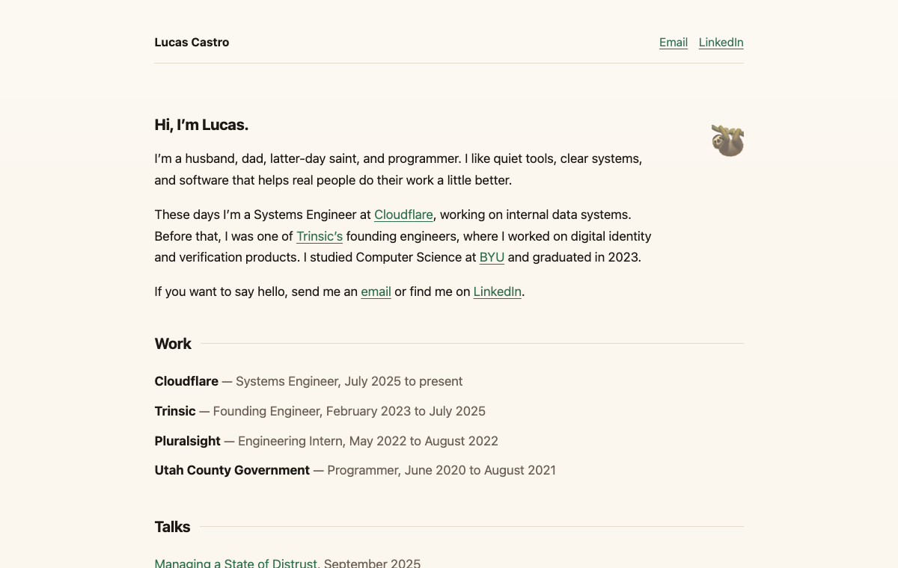
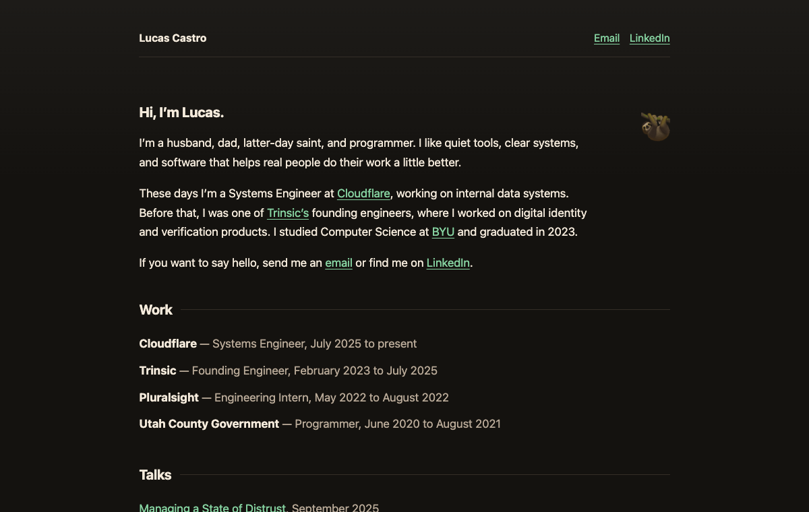

<div align="center">

# lucasacastro.com

**My personal homepage: a single Markdown page, statically built and served from Cloudflare's edge.**

[lucasacastro.com](https://lucasacastro.com)


<table>
  <tr>
    <td></td>
    <td></td>
  </tr>
</table>

</div>

## Principles

The site is deliberately small. It should load instantly, read well and need almost no maintenance.

- **One page, written in Markdown.** All the content lives in [`src/pages/index.md`](src/pages/index.md).
- **Zero client-side JavaScript.** No framework runtime, no MDX, no content collections, no blog.
- **Native CSS** in [`src/styles/global.css`](src/styles/global.css), with light and dark themes that follow
  `prefers-color-scheme`.
- **Static output only.** Astro builds to `dist/`, and Cloudflare serves it as static assets.

## Development

```bash
npm install
npm run dev       # local dev server
npm run build     # static build → dist/
npm run preview   # preview the build
```

```
src/pages/index.md             homepage content
src/pages/404.astro            not-found page
src/layouts/Root.astro         document shell
src/components/                head, navigation, footer
src/styles/global.css          all the styles
public/                        favicon, robots.txt
wrangler.jsonc                 Cloudflare static assets config
```

## Deployment

`npm run build`, then deploy `dist/` with Cloudflare using the assets config in
[`wrangler.jsonc`](wrangler.jsonc).
